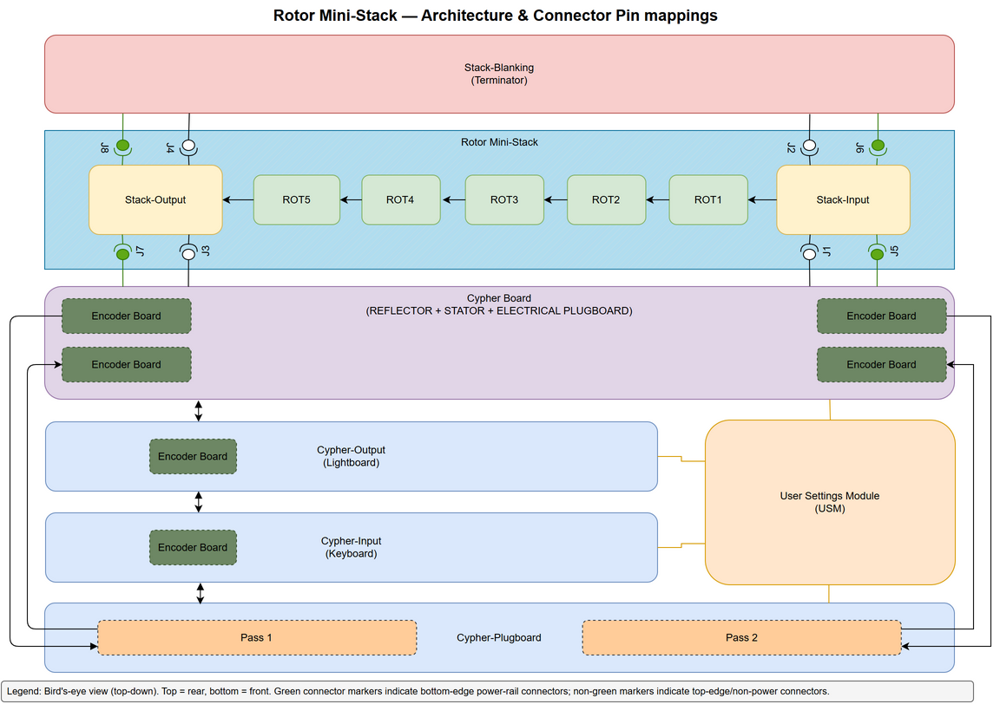
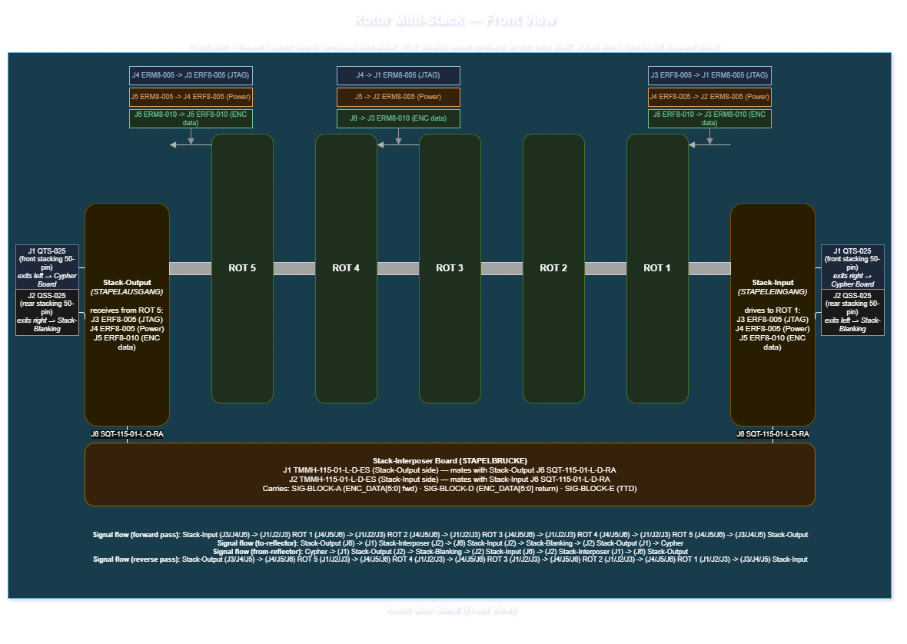
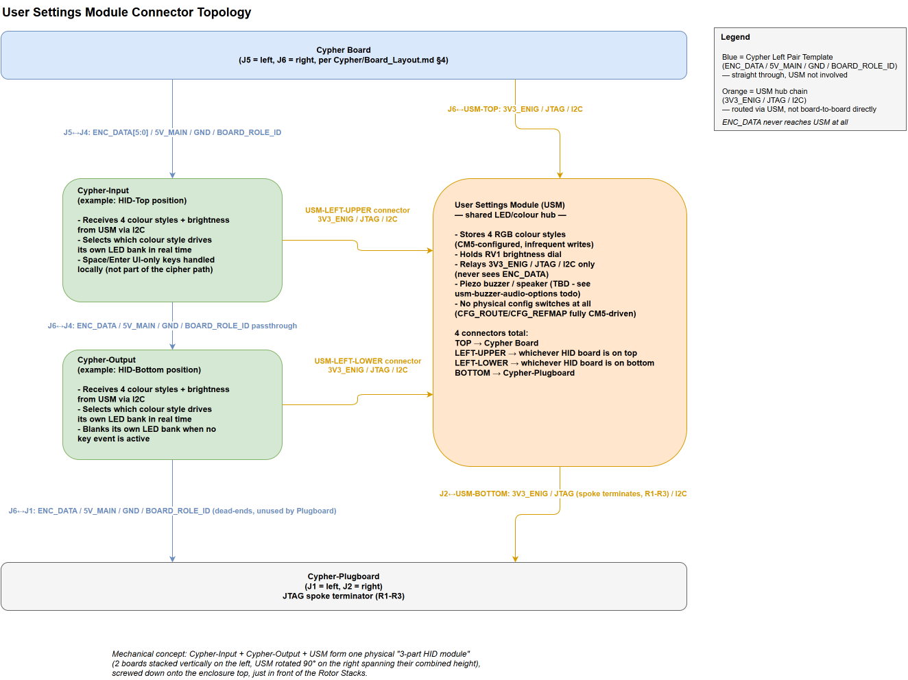

# Enigma NG: Digital Cryptography Ecosystem

The Enigma-NG is an advanced "Museum-Grade", modular, and historically-accurate digital recreation of the world’s most iconic encryption machines.
Powered by a **Raspberry Pi Compute Module 5 (CM5)**, this system controls a hardware stack of up to 30 custom CPLD-based rotors and a physical 64-jack plugboard.
Powered with either USB-C Power Adapter, PoE+ or Smart Battery. It bridges 1940s mechanical heritage with 2026 high-speed digital engineering.

## 🚀 Project Vision

To create a high-fidelity, educational, and industrially robust encryption platform.
The design prioritises classroom safety, professional EMI shielding, and deep hardware visibility for students via an integrated diagnostic bank.
Beyond a simple Enigma clone, this terminal is a **Universal Cipher Engine**. The hardware is designed to emulate:

* **Enigma Variants:** I, M3, M4, and Abwehr.
* **Typex:** The 5-rotor British adaptation with simulated printer output.
* **SIGABA:** The 15-rotor US system using complex 3-bank stepping algorithms.
* **NG-26** The modern digital enigma machine designed and created by Matthew McAtamney-Greenwood.

One of the long-term goals of this project is to introduce the ability to deliver Enigma encrypted data over the network,
and even provide the ability to deliver encrypted files using a base-64 encoding before executing the standard rotor-based encryption.
This end-goal will involve the definition of a new RFC for the "Enigma-Packet-Protocol (EnPP)", which will be a custom specification for this project's ecosystem.

## Tools Used

* **Visual Studio Code:** To manage the Documentation within this repository.
* **Visual Studio:** (Latest Community Edition) To develop the GUI Application.
* **KiCAD 9:** To develop the electrical components and PCB layouts.
* **OnShape:** To create and manage the mechanical designs and assemblies.
* **Yocto:** To create the custom Linux OS with built-in drivers and GUI Application.

## Core Component Overview

* **Controller Board:** Raspberry Pi Compute Module 5 (CM5) carrier board hosting the fixed
  motherboard, external I/O, and service docks.
* **Power Module:** Removable power-conditioning / UPS cartridge with PoE, USB-C, smart-battery
  inputs, eFuse protection, and supercap-backed hold-up.
* **Cypher Board:** Fixed backplane fulfilling the historical Stator, Reflector, and JTAG-bridge
  roles in a single consolidated board, plus the electrical Plugboard-pass Encoder Modules. Hosts
  the rotor mini-stack and HID-pair docks.
* **Rotor Module:** Repeated smart encryption unit (up to 30 fitted, 5 per mini-stack) with local
  CPLD and position sensing.
* **Rotor Mini-Stack:** A Stack-Input board, up to 5 Rotor Modules, and a Stack-Output board, with
  a Stack-Interposer delivering signals between the Stack-Input/Stack-Output sides to allow
  mini-stacks to be chained; the final mini-stack is terminated by a Stack-Blanking panel.
* **Cypher-Input / Cypher-Output:** HID-pair boards (Keyboard / Lightboard roles), each available
  in multiple variants (10-Numeric, 26-Char, 64-Char).
* **Cypher-Plugboard:** Mechanical jack panel for the physical plugboard; the electrical Encoder
  Modules for this role live on the Cypher Board itself.
* **Encoder Module:** Single generic daughterboard carrying one Programmable Hardware IC
  (CPLD/FPGA) and its required passive components, reused across the Cypher Board,
  Cypher-Input, and Cypher-Output.
* **User Settings Module (USM):** Panel-mount colour / brightness / buzzer configuration board,
  hosted off the Cypher Board's Cypher-peripherals I2C bus.

## Core Requirements

* **Interface:** Controller ↔ Power Module uses three TE 10-position 2.5mm dock connectors; Controller
  ↔ Cypher Board uses a split power/signal pair - Molex EXTreme Guardian HD (power-only) and
  Samtec QSS/QTS-025 (signal-only).
* **Diagnostics:** Two ENIG diagnostic banks are provided on the Controller for the PM and Cypher
  Board dock interfaces.
* **UI:** .NET 10.0 Cross-platform GUI with:
  * Live power telemetry.
  * Historical resources.
  * 3D graphical visualiser.
  * Configuration programmer (and creator).

## Board Status Snapshot

| Board | Status |
| :--- | :--- |
| Controller Board | In Review |
| Power Module | In Review |
| Cypher Board | In Review |
| Cypher-Input | In Review |
| Cypher-Output | In Review |
| Cypher-Plugboard | In Review |
| Rotor Module | In Review |
| Stack-Input | In Review |
| Stack-Output | In Review |
| Stack-Interposer | In Review |
| Stack-Blanking | In Review |
| Encoder Module | In Review |
| User Settings Module | In Review |

## 🗺️ System Architecture

*Full diagram source: [`design/Diagrams/cypher-and-stack-configuration-diagrams.drawio`](design/Diagrams/cypher-and-stack-configuration-diagrams.drawio)*

---

## 🔌 Hardware Architecture

### 1. Power Module (The Heart)

* **Input:** Triple-input OR-ing between PoE+ 802.3bt Type 4, USB-C 15V PD, and Battery
  11–16.4V via LM74700-Q1 + CSD17483F4T ideal-diode FETs. PoE is explicitly prioritised over
  USB-C; USB-C vs Battery precedence follows the active input voltages unless extra gating is added.
* **PoE:** Fully discrete 802.3bt Type 4 front end — TPS2372-4 (PD interface) + TPS23730 (ACF DC-DC) + TDK B82806D0060A120 ACF Forward transformer stage. Implemented 12V power stage capacity: 60W.
* **Protection:** TPS25980 eFuse — 7A ILIM, 11.0V UVLO, 16.9V OVLO, 3mΩ RON. Plus 72°C TCO thermal fuse.
* **Buck:** Dual-phase interleaved LMQ61460-Q1 (×2, 6A each, 12A combined, 400kHz DRSS, 180° SYNC). Effective ripple: 800kHz.
* **LDO:** TPS75733KTTRG3 3V3_ENIG (8.8µVRMS noise, 72dB PSRR, 3A, 2.22 A typical load at 74.0% utilisation).
* **UPS:** LTC3350 supercap manager + 8× Abracon ADCR-T02R7SA256MB (2S4P, 50 F) on 5V_MAIN bus. 50 F at 5.4V → ≥33.5 second hold-up for clean CM5 shutdown.
* **Output Rails:** 5V_MAIN (12A) and 3V3_ENIG (3A — logic, CPLDs, and rotor stack) via BtB connectors to Controller Board for distribution.
* **Panel Controls:** SW1 is a rugged latching RGB power toggle (Adafruit 4660) and SW2 is a
  matching 16mm momentary RGB CM5 power button (Adafruit 3350); both are panel-mounted controls
  wired to the Power Module harness.

### 2. Controller Board (The Brain)

* **Module:** Raspberry Pi CM5 (BCM2712) on a custom 6-layer 2oz carrier.
* **Power Input:** 3-way seamless switching (LM74700-Q1 ideal-diode on Power Module).
  * **Smart Battery:** 5-pin Molex Micro-Fit connector (11V-16.4V nominal) with SMBus telemetry + BATT_PRES_N.
  * **PoE+ (802.3bt Type 4):** Power-over-Ethernet delivered through the Power Module discrete
    TPS2372-4 + TPS23730 + TDK B82806D0060A120 ACF Forward path. The implemented 12V stage is sized at 60W. Single
    Ethernet cable carries both data and power.
  * **USB-C PD:** 15V USB-C PD negotiated input.
* **Protection:** Over-voltage and over-current protection provided by Power Module eFuse upstream; local reverse-polarity and ESD protection on BtB interface.
* **Rotor Rail:** The rotor stack is powered by the **3V3_ENIG** rail (TPS75733KTTRG3 LDO, 3A) generated on the Power Module; routed to the rotor mini-stack via Controller Board → Cypher Board.
  CM5 GPIO 16 (ROTOR_EN) gates the LDO enable for sequenced power-up.
* **JTAG Master:** Routes JTAG through the signal-only Cypher Board dock (`J5`) to the Cypher
  Board's own JTAG bridge IC (FT232H).
* **Connectivity:** Native USB 3.0 (SMT), HDMI (SMT), and Gigabit Ethernet.

### 3. Cypher Board (Nervous System)

* **Routing Hub:** The Cypher Board's Programmable Hardware IC is the ENC_DATA routing matrix,
  reflector-map application point, and first device in the system JTAG chain.
* **Interconnects:** Hosts the Controller dock, rotor mini-stack docks, the HID-pair (Cypher-Input/
  Cypher-Output) docks, the Hub Connector Template to the User Settings Module, and its own
  electrical Plugboard-pass Encoder Modules.
* **Peripherals:** Owns the rotor-stack INA219 current monitor, three MCP23017 expanders, and the
  USB-to-JTAG bridge IC (FT232H).

### 4. Encoder Module (Universal Interface)

* **Generic PCB:** One single-sided board carrying a single Programmable Hardware IC (CPLD/FPGA)
  and its required passive components; reused on the Cypher Board (electrical Plugboard-pass
  role), Cypher-Input (Keyboard role), and Cypher-Output (Lightboard role).
* **HID Path:** Physical keyboard layout is 40 positions (`[a-z0-9+=]` plus left / right Shift),
  while the logical repertoire remains the full 64-character code space.
* **Plugboard Path:** Two Encoder Module pairs on the Cypher Board provide the two configurable
  passive plugboard passes.

### 5. User Settings Module (Configuration Panel)

* **Role:** User-accessible configuration board for colour, brightness, and buzzer settings.
* **Interface:** Hosted off the Cypher Board's Cypher-peripherals I2C bus via the Hub Connector
  Template, relaying JTAG and the Cypher-peripherals I2C bus onward to the HID pair and
  Cypher-Plugboard.

### 6. Rotor Module (The Engine)

* **Logic:** Intel **MAX II EPM570T100I5N** CPLD.
* **Dimensions:** Ø92 mm PCB / **Ø100 mm shroud outer**.
* **Segments:** 64 characters with **8mm arc width** for high readability.
* **Memory:** 10 pre-loaded bidirectional wiring sets; 4-position DIP switch for "Rotor Identity" selection.
* **Sensing:** FDC2114RGHR capacitive encoder ICs (dual-track, 3+3 per rotor).
* **Tri-Connector Bus:**
  * Power (2x2), JTAG (2x4 Shielded), and Enigma (2x6 Bidirectional Relay) in a "Tripod" layout.

### 7. Rotor Mini-Stack (Stack-Input / Stack-Output / Stack-Interposer / Stack-Blanking)

* **Role:** A Stack-Input board, up to 5 Rotor Modules, and a Stack-Output board form one
  mini-stack. Mini-stacks chain together via front/rear connectors on the Stack-Input/Stack-Output
  boards themselves (all Stack-Inputs connect to each other on one side, all Stack-Outputs on the
  opposite side); a Stack-Interposer board delivers the relevant signals between a mini-stack's own
  Stack-Input side and Stack-Output side.
* **JTAG Support:** Each Stack-Input board re-buffers `TCK` and `TMS` to
  restore timing margin for its mini-stack; the Stack-Interposer is pass-through only.
* **Termination:** The final mini-stack in the chain is terminated by a Stack-Blanking panel, which
  provides the physical `ENC` return path and renames the outbound `TTD` signal to `TTD_RETURN`.
* **Actuation:** Each Stack-Input board hosts a native STM32 MCU for local solenoid/motor
  actuation.

*Full diagram source: [`design/Diagrams/cypher-system-layout.drawio`](design/Diagrams/cypher-system-layout.drawio)*

### 8. Cypher - HID (Human Interface Devices)

*Full diagram source: [`design/Diagrams/usm-connector-topology.drawio`](design/Diagrams/usm-connector-topology.drawio)*

#### 8.1 Cypher-Input / Cypher-Output (HID Pair)

* **Role:** HID-pair boards implementing the Keyboard (Cypher-Input) and Lightboard
  (Cypher-Output) roles, each carrying one Encoder Module and available in multiple variants
  (10-Numeric, 26-Char, 64-Char).

#### 8.2 Cypher-Plugboard

* **Role:** Mechanical jack panel for the physical plugboard. The electrical Encoder Modules that
  implement the Plugboard-pass logic live on the Cypher Board itself, not on this board.

---

## 💻 Software Implementation

### 1. Linux Kernel Driver

* **Interrupt Handling:** High-priority monitoring of the `KEY_EVENT_INT` line.
* **State Mapping:** Maps 6-bit Input/Return Path to `/dev/enigma_state`.
* **Power Telemetry:** Exposes SMBus battery data and PoE status to userspace.
* **JTAG Control:** Executes Boundary Scan (SAMPLE/PRELOAD) upon keypress trigger.

### 2. .NET 10 GUI (The Terminal)

* **Binary File Transfer:** Encrypts files via Base64 encoding/decryption through the hardware rotors.
* **Ethernet/UDP Interface:** Secure 6-bit encrypted UDP streams for remote terminal communication.
* **Power Dashboard:** Real-time monitoring of Battery (SoC/Temp), PoE+, and USB-C sources.
* **Rotor Library Manager:** Visual tool to design custom wiring and flash the 30-rotor stack.
* **Historical Archive:** Educational database of Enigma, Typex, and SIGABA variants.

### 3. VHDL Firmware (The Navigators)

* **Cypher Board CPLD:** Owns the routing matrix, plugboard insertion positions, reflector-map
  application, and source-selection handoff between keyboard and CM5 virtual input.
* **Rotor CPLDs:** Implement the rotor wiring libraries and per-rotor identity selection.
* **Encoder CPLDs:** Provide the encode / decode logic used by the keyboard, lightboard, and both
  plugboard passes.
* **Status:** Board-level hardware architecture is defined in the active design specs; implementation
  planning and pseudo-code remain tracked as open work in `design/Design_Log/index.md`.

---

## ⚠️ Safety & Design Rules (KiCAD 9)

* **eFuse Latch-off:** Electronic fault protection requires manual power cycle to reset.
* **Soft Start:** SW1 drives the TPS25980 eFuse EN pin; the CM5 separately gates the 3V3_ENIG LDO with ROTOR_EN.
* **ESD Hardening:** TVS diodes on all exposed pins (JTAG, Enigma, and 64-jack lines).
* **Stackup:** Mixed stackup architecture: Controller Board and Power Module are 6-layer boards; the remaining electronics boards are 4-layer / 2oz designs.

---

## 📅 Development Roadmap

1. **LED/keyboard PoC:** decide between analog multi-colour-bank and addressable LED approaches for
   Cypher-Input/Cypher-Output.
2. **HID module mechanical review:** finalise mechanical design for the Cypher-Input/Cypher-Output/
   USM 3-part HID assembly.
3. **Battery connector review:** confirm whether alternative battery-connector options should replace
   or supplement the present Power Module choice.
4. **Coupon / acceptance-test planning:** add and review board-level coupons and acceptance-test hooks
   across the design set.
5. **Review passes and interim electronics review:** complete clean-pass verifications before
   proceeding to prototype PCB manufacturing.
6. **Prototype PCB manufacturing:** first physical build run.
7. **Initial Firmware & Software builds and testing.**
8. **Compliance / EMC / environmental testing:** certification test phase.
9. **Final Firmware & Software builds & testing.**
10. **Version 1.0 milestone:** overall project documentation and completion package.
11. **Security review & pen testing.**

## Contributions

This is an open-source development project. Contributions are welcomed from all.
When submitting an issue please ensure you provide the SHA commit hash for the version of code that exhibits your issue and provide full replication steps.
For any contributions, please create a Pull Request and ensure useful commit messages are provided.
Once a PR is accepted the changes with be squashed into the current working branch of this repository and your name will be added to the list of contributors.

<!-- readme: collaborators,contributors -start -->
<table>
	<tbody>
		<tr>
            <td align="center">
                <a href="https://github.com/thepinkmile">
                    
                     
                    <b>The Pink Mile Developer</b>
                </a>
            </td>
		</tr>
	<tbody>
</table>
<!-- readme: collaborators,contributors -end -->

## Licensing

For enquiries regarding educational licensing, please contact the maintainer.
This repository is licensed under the GNU GENERAL PUBLIC LICENSE v3.
