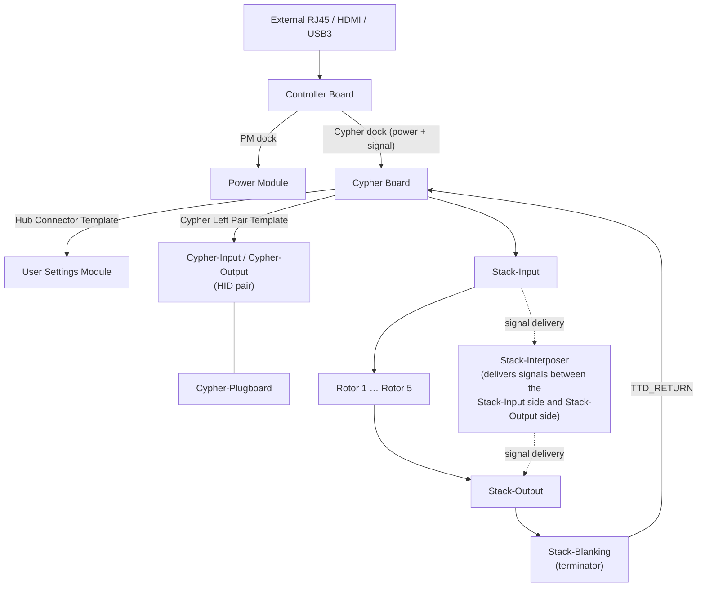
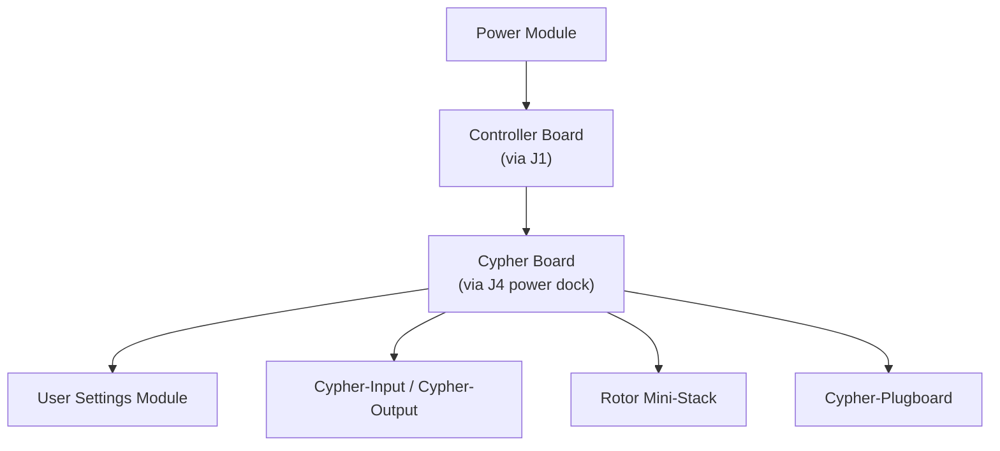
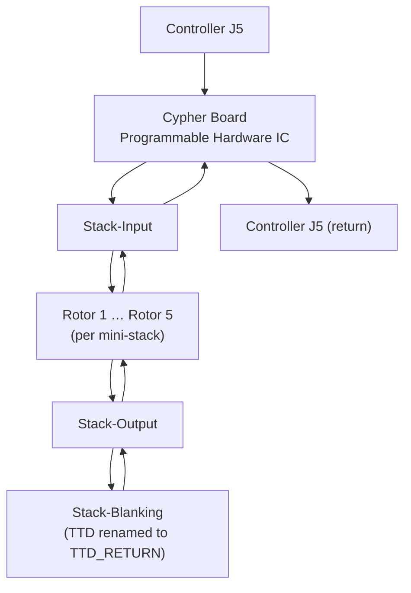

# Enigma-NG System Architecture

**Status:** Draft
**Project:** Enigma-NG
**Author:** Izzyonstage & GitHub Copilot
**Version:** v.0.1.0
**Associated Hardware Revision:** Rev A
**Last Updated:** 2026-10-28

---

## 1. Board Hierarchy and Physical Structure

The Enigma-NG system comprises the following boards:

- **Controller Board (CM5)** - Raspberry Pi CM5 carrier and the mechanical motherboard of the machine.
  Hosts the external RJ45, Ethernet ESD/magnetics, PoE front-end, HDMI, USB 3.0, and the dock
  interfaces to both the Power Module and the Cypher Board.
- **Power Module** - Removable power-conditioning / UPS cartridge. Accepts local USB-C and battery
  inputs plus a regulated PoE-derived auxiliary feed from the Controller; generates `5V_MAIN` and
  `3V3_ENIG`, manages hold-up energy, and remains the only intentional `GND` ↔ `GND_CHASSIS` bond.
- **Cypher Board** - Fixed backplane mounted from the enclosure wall. Receives power and
  logic from the Controller through a split power/signal dock pair; fans power and JTAG into the
  rotor mini-stack and the HID pair, and hosts the routing/reflector programmable logic plus the
  electrical Encoder Modules for the Plugboard-pass role. Fulfils the historical Stator, Reflector,
  and JTAG-bridge roles in a single consolidated board.
- **User Settings Module** - Panel-mount colour/brightness/buzzer configuration board, hosted off
  the Cypher Board's Cypher-peripherals I2C bus via its Hub Connector Template.
- **Cypher-Input / Cypher-Output** - HID-pair boards (Keyboard / Lightboard roles), each carrying
  one Encoder Module; available in multiple variants swapped depending on the required
  configuration (see `Boards_Overview.md §1`).
- **Cypher-Plugboard** - Mechanical jack panel for the physical plugboard; the electrical Encoder
  Modules for this role live on the Cypher Board itself.
- **Rotor Mini-Stack** - A Stack-Input board, up to 5 Rotor Modules, and a Stack-Output board form
  one mini-stack. Chaining multiple mini-stacks together connects all Stack-Input boards to each
  other on one side and all Stack-Output boards to each other on the opposite side (via their own
  front/rear connectors); a Stack-Interposer board delivers the relevant signals between the
  Stack-Input side and the Stack-Output side within each mini-stack so the overall stack still
  functions correctly across this arrangement. The final mini-stack in the chain is terminated by
  a Stack-Blanking panel.
- **Stack-Input** - Mini-stack input board; buffers the incoming JTAG signals (`TCK`/`TMS`) for the
  mini-stack and also hosts the native Actuation Module MCU for local solenoid/motor actuation.
- **Stack-Output** - Mini-stack output board.
- **Stack-Interposer** - Pass-through signal trace connection board only (no buffering); delivers
  power, JTAG, and the other required signals between a mini-stack's Stack-Output side and its
  Stack-Input side, enabling the Stack-Input/Stack-Output chaining described above.
- **Stack-Blanking** - Mandatory terminating panel after the final mini-stack; provides the
  physical `ENC` return path and renames the outbound TTD signal to `TTD_RETURN` for the trip back
  to the Cypher Board.
- **Rotor Module** - Up to 30 smart encryption units, arranged 5 per mini-stack, chaining directly
  output-to-input within a mini-stack.
- **Encoder Module** - Generic daughterboard carrying one Programmable Hardware IC (CPLD/FPGA) and
  its required passive components; role (Keyboard / Lightboard / Plugboard pass) is set by the
  carrier board it mounts to. Mounts on the Cypher Board, Cypher-Input, and Cypher-Output.

### Physical Chain

The Power Module and the Rotor Mini-Stack are both removable/reconfigurable. The Controller is the
fixed mechanical reference that mates to the Power Module and the Cypher Board and owns all
enclosure-edge I/O.

---

## 2. Interconnect Architecture

### 2.1 Controller ↔ Power Module

The Controller ↔ Power Module dock uses three 10-position TE 2.5 mm board-to-board connectors,
split by function:

| Link | Function |
| :--- | :--- |
| J1 | Main regulated rails (`5V_MAIN`, `3V3_ENIG`, `GND`) |
| J2 | Regulated PoE-derived auxiliary input (`VIN_POE_12V` + `GND`) |
| J3 | Low-speed control / telemetry (`I2C0`, `PM_IO_INT_N`, `PWR_GD`, `ROTOR_EN_N`, `PWR_BUT_N`, `LED_PWR_N`) |

Connector part numbers, exact pin counts, and datasheet references are owned by
`Controller/Design_Spec.md` and `Power_Module/Design_Spec.md`.

### 2.2 Controller ↔ Cypher Board

The Controller ↔ Cypher Board dock uses a split power/signal connector pair:

| Link | Function |
| :--- | :--- |
| J4 | Power-only dock (`5V_MAIN`, `3V3_ENIG`, `GND`) |
| J5 | Signal-only dock (JTAG, I2C buses, USB D+/D-, PWM/GPCLK) |

`J5` carries the active `I2C1` (Cypher-local) and `I2C2` (Cypher-peripherals / USM / HID lighting)
buses plus reserved `I2C3`/`I2C4`/`I2C6` buses - see §5. Connector part numbers, exact pin
allocations, and datasheet references are owned by `Controller/Design_Spec.md` and
`Cypher/Design_Spec.md`.

### 2.3 Rotor-Stack Connectors

Two distinct connector philosophies apply within the rotor mini-stack:

- **Rotor-internal hops** (Rotor-to-Rotor, Rotor-to-Stack-Input, Rotor-to-Stack-Output) remain on
  the Samtec Edge-Rate series 0.8 mm board-to-board connectors: **ERM8** (male header, originating
  side) and **ERF8** (female socket, receiving side).
- **Enclosure-boundary connectors** on the mini-stack boards themselves (Stack-Input, Stack-Output,
  Stack-Interposer, Stack-Blanking) follow the flush(female)/protruding(male) mating convention in
  `Global_Routing_Spec.md §4.1a` instead, since these connectors span gaps in the enclosure rather
  than mating directly to a Rotor board.

---

## 3. Power Architecture

The Power Module produces two rails from three upstream sources:

- **Controller-fed PoE auxiliary:** `VIN_POE_12V` enters the PM from the Controller after the RJ45,
  PoE PD, transformer, and cable-entry EMI/ESD stages.
- **Local USB-C PD input:** handled on the Power Module.
- **Local smart-battery input:** handled on the Power Module.

Generated rails (component-level detail is owned by `Power_Module/Design_Spec.md`):

- **5V_MAIN** - Up to 12A; dual-phase interleaved buck converter.
- **3V3_ENIG** - Clean 3.3V; linear regulator post-regulation stage.

### Grounding Rule

Every enclosure-connected board implements a local `GND_CHASSIS` net and ties its mounting holes
and any shield/enclosure-contact features to it, per `Global_Routing_Spec.md §5`, so the metal
enclosure forms one continuous chassis domain across the machine. **Only the Power Module**
terminates this `GND_CHASSIS` domain to signal/power `GND` - at a single galvanic bond point as
close as possible to the incoming power rails (downstream of source-selection/OR-ing, immediately
before the eFuse), acting as the return path for enclosure-coupled transients and shield currents.
No other board may create a second `GND` ↔ `GND_CHASSIS` bond; doing so would create a ground loop.

### 3V3_ENIG Power Flow

---

## 4. JTAG Serial Chain (TTD Net)

### TTD Net Name

The JTAG serial chain data pin is designated **TTD** (JTAG Transmission Data) on all rotor-stack
JTAG connectors; the exact pin number is owned by each board's own `Board_Layout.md`. This unified
name avoids TDI/TDO direction confusion:

- On the input side: TTD carries incoming TDI from the previous stage.
- On the output side: TTD carries outgoing TDO to the next stage's TDI.

### Serial Chain Path (Controller -> Stack-Blanking -> TTD_RETURN)

### TCK and TMS - Broadcast Signals

**TCK** and **TMS** are broadcast signals. They leave the Controller via the Cypher Board signal
dock (`J5`) and then propagate through the rotor mini-stack in parallel.

### Mini-Stack Chaining Signal Buffering

Each mini-stack's Stack-Input board buffers the incoming **TCK** and **TMS** signals for that
mini-stack; the buffer IC used is owned by `Stack-Input/Design_Spec.md`. Those signals then
propagate through the Rotors, across the Stack-Interposer (a pass-through signal trace connection
only - no buffering), and back to the Stack-Input board, which forwards them on to the next
mini-stack's Stack-Input board (or to Stack-Blanking if this is the last mini-stack in the chain).
**TTD is NOT buffered** anywhere in this path - it is a serial chain signal and must pass
uninterrupted through each CPLD.

### Signal Integrity

Idle-state bias resistors (JTAG spoke-signal pull-up/pull-down termination) and the TTD
series-termination resistor at the chain's physical end are board-local implementation detail;
see `Rotor/Design_Spec.md` and `Stack-Blanking/Design_Spec.md` for the exact values and placements.

---

## 5. I2C Topology

System management devices are distributed across the Controller's independent I2C bus instances
(`I2C0` PM-dedicated; `I2C1`/`I2C2` active Cypher buses; `I2C3`/`I2C4`/`I2C6` reserved) - see
`Boards_Overview.md §4` for the bus-routing topology.

> **Authoritative I2C address table:** see `Controller/Design_Spec.md §4.1` for the full list of
> device addresses, locations, and functions across all boards sharing these buses (Power
> Module, Cypher Board, User Settings Module, Cypher-Input). This section documents topology only, to
> avoid duplicating a table that must otherwise be kept in sync in two places.

The PM-local expander uses the address block adjacent to the PM INA219 so PM devices remain grouped in
`i2cdetect` output.
